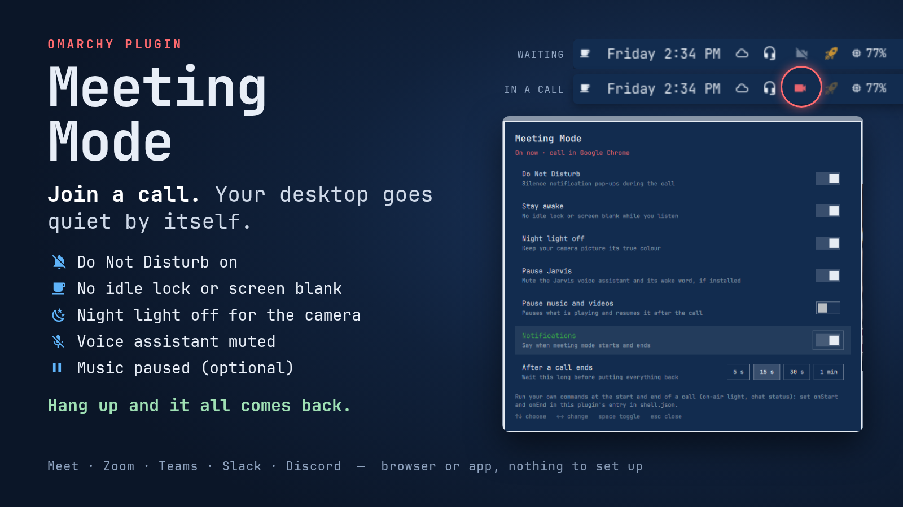
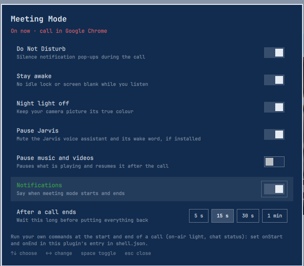

# Meeting Mode for Omarchy

**Join a call and your desktop goes quiet by itself. Hang up and everything comes back.**

No button to remember. No calendar to connect. Meeting Mode notices when a call app starts
using your microphone (Google Meet, Zoom, Teams, Slack, Discord and more, in the browser or
as an app) and gets your desktop out of the way until the call is over.



## What happens when a call starts

| | During the call | After you hang up |
|---|---|---|
| **Do Not Disturb** | Notification pop-ups stay silent | Back on, if they were on before |
| **Stay awake** | No idle lock or screen blank while you listen | Normal idle behaviour returns |
| **Night light** | Off, so your camera picture isn't tinted orange | Back to the exact temperature it had |
| **Jarvis** voice assistant | Muted, and its wake word stops listening | Talking and listening again |
| **Music and videos** *(optional)* | Paused | Resumed where they left off |

Meeting Mode only undoes what it changed. If Do Not Disturb or Stay Awake was already on
before the call, it stays on afterwards. It keeps a record of its changes on disk, so even a
shell restart in the middle of a call can't leave your desktop stuck in meeting mode.

A bar indicator shows a dim camera while it waits and lights up in your theme's alert
colour during a call. Hover it to see which app started the meeting, how long the call has
been going and what was changed.

## Install

Review the source first. Like every Omarchy plugin, it runs unsandboxed inside
`omarchy-shell`. Then:

```bash
omarchy plugin add https://github.com/jburchel/omarchy-meeting-mode.git
omarchy restart shell
```

Accept the prompt to enable it and pick a bar section for the indicator (**center** is
preselected). Move it later with `omarchy plugin enable io.github.jburchel.meeting-mode --section right`.
The background service starts with the shell, so meeting mode works even without the
indicator on the bar.

To try it without a real call, play a few seconds of "microphone in use" from a terminal:

```bash
pw-record -P '{ application.name = "Google Chrome" }' /dev/null   # Ctrl+C to hang up
```

## Use it

It is automatic: start a call, and three seconds later meeting mode is on. Fifteen
seconds after the last call app lets go of the microphone, everything is put back. The
short wait on both ends rides out mic tests and brief reconnects.

| On the bar indicator | |
|---|---|
| Click | Turn meeting mode on or off now |
| Right-click | Settings |
| Middle-click | Back to automatic |

Turn it off by hand during a call and it stays off until that call ends. Turn it on by hand
with no call and it stays on until you turn it off.

From a terminal or a keybinding:

```bash
omarchy-shell meeting-mode toggle     # or: on | off | auto
omarchy-shell meeting-mode status     # JSON: active, call app, what changed
omarchy-shell meeting-mode settings   # open the settings panel
```

## Settings

Right-click the indicator, or run `omarchy-shell meeting-mode settings`. Every action has its
own switch, and you choose how long to wait after a call before putting things back
(5 s, 15 s, 30 s or 1 min). Changes apply from the next meeting.



Settings are saved in this plugin's entry in `~/.config/omarchy/shell.json`. Two more can only
be set there:

```json
{
  "id": "io.github.jburchel.meeting-mode",
  "onStart": "curl -s -X POST http://homeassistant.local:8123/api/webhook/on-air",
  "onEnd": "curl -s -X POST http://homeassistant.local:8123/api/webhook/off-air",
  "callApps": "chrom|firefox|zoom|teams|slack|discord|mumble"
}
```

- **`onStart` / `onEnd`**: any shell command, run when a meeting starts and ends. Turn on an
  "on air" light, set your chat status, start a recording, light a Stream Deck key.
- **`callApps`**: which apps count as a call, matched against the app name and program name of
  anything recording from the microphone (a case-insensitive regular expression). The default
  covers Chrome, Chromium, Firefox, Brave, Vivaldi, Zen, LibreWolf, Zoom, Teams, Slack, Webex,
  Discord, Skype, Jitsi, Signal, Telegram and Element.

## How it works

The service is a small QML component inside `omarchy-shell`. It uses the shell's built-in
PipeWire connection to see which apps have a microphone stream open, so there is no polling
and no extra process. It never opens the microphone itself and never touches audio: it only
reads which apps are recording.

The desktop changes are made by `bin/meeting-mode-actions`, a small shell script you can read
in a minute. It uses Omarchy's own commands (`omarchy toggle notification silencing`,
`omarchy toggle idle`, `hyprctl hyprsunset`) and records each change in
`~/.local/state/meeting-mode/` so it can undo exactly those.

Recording apps that aren't call apps (OBS, Audacity, dictation tools, the Jarvis wake word)
never start meeting mode.

## Update

```bash
omarchy plugin update io.github.jburchel.meeting-mode
omarchy restart shell
```

## Remove

```bash
omarchy-shell meeting-mode off
omarchy plugin remove io.github.jburchel.meeting-mode
```

Turning it off first puts back anything a current meeting changed.

## Tests

```bash
node tests/model.test.js        # which apps count as a call, settings defaults and limits
node tests/qml-text.test.js     # app names are always shown as plain text
bash tests/actions.test.sh      # on/off undoes exactly what changed (uses stand-in commands)
```

## More Omarchy plugins by Jim Burchel

- **[Jarvis](https://github.com/jburchel/omarchy-jarvis)**: a voice for the AI agent in your
  terminal. Claude Code, Codex or Gemini CLI read their replies aloud, and "Hey Jarvis" starts
  hands-free dictation. Meeting Mode mutes it during calls automatically.
- **[Workspace Names & Icons](https://github.com/jburchel/omarchy-workspace-nameplates)**: give
  every workspace a name and an icon right in the bar. Double-click to edit; the numbers stay.
- **[Omarchy Alt-Tab](https://github.com/jburchel/omarchy-alt-tab)**: hold Alt and tap Tab
  through live previews of your windows, like Windows and macOS.

If Meeting Mode saved you from a notification mid-presentation, a ⭐ on GitHub helps other
people find it.

## License

MIT. See [LICENSE](LICENSE).
